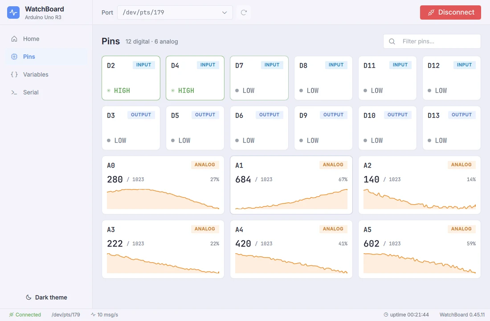

# WatchBoard

**See what your microcontroller is doing, in real time.**

WatchBoard is a desktop dashboard for Arduino, ESP32 and friends. Add a small library to your sketch, plug the board in over USB, and watch its pins, variables and serial traffic live, without a single `Serial.print`.


<picture>
  <source media="(prefers-color-scheme: dark)" srcset="docs/img/tab2-dark.webp">
  
</picture>

**[Website and full documentation →](https://ajunior.github.io/watchboard/)** · **[Download](https://github.com/ajunior/watchboard/releases/latest)**

---

## Why WatchBoard

The Serial Monitor shows you raw text; dashboard tools want a server, flows and a browser tab. WatchBoard is a native app that opens in a second and shows the board as it is right now.

- **Debug by looking, not by printing.** Instead of sprinkling `Serial.print` and reading a wall of text, watch pins and values change as the code runs, ten snapshots a second.
- **Five lines of firmware.** Register pins, name the values you care about, call `update()` in `loop()`. Non-blocking, no dependencies.
- **Talk back to the board.** Flip an output pin with a switch, or type a line and send it, with history, from the Serial tab.

**Home**: board name, port, CPU speed, free RAM, flash, uptime, reset reason and message rate, plus your pin labels.
**Pins**: digital pins as HIGH/LOW, analog pins with a value bar and a 60-sample sparkline. Toggle outputs, rename and filter pins.
**Variables**: every watched value in a table, plotted over the last 30 seconds. Hide a line and the axis rescales to what's left.
**Serial**: the raw traffic in both directions, with timestamps. Send lines to the board and save the session to a file.

Light and dark theme, switched with <kbd>Ctrl</kbd>+<kbd>D</kbd>.

---

## Quick start

1. **Install the app.** Grab the build for your system from the [releases page](https://github.com/ajunior/watchboard/releases/latest): the `.AppImage` for Linux, the `.dmg` for macOS 13+, the `-setup.exe` for Windows. Or [build it from source](#building-from-source).
2. **Add the library to your sketch.** Download `WatchBoard-library-<version>.zip` from the same release and add it with *Sketch → Include Library → Add .ZIP Library…* (or copy `firmware/WatchBoard` into your Arduino `libraries` folder), then:

   ```cpp
   #include <WatchBoard.h>

   void setup() {
       pinMode(2, INPUT);
       WatchBoard.watchDigital(2);
       WatchBoard.watchAnalog(A0);
       WatchBoard.begin(Serial);        // 115200 baud
   }

   void loop() {
       WatchBoard.watch("voltage", analogRead(A0) * (5.0f / 1023.0f));
       WatchBoard.update();             // non-blocking: call it every loop
   }
   ```

3. **Upload it, then connect.** Close the Arduino Serial Monitor (only one program can hold the port), open WatchBoard, pick the board's port and click **Connect**. You can also connect on startup with `watchboard --port /dev/ttyACM0`.

The library supports AVR (Uno, Mega, Nano…), SAMD, ESP32 and ESP8266 boards, and ships with an example: *File → Examples → WatchBoard → BasicMonitor*. Pin labels are saved in a profile, a small JSON file you can keep next to your sketch. See the [documentation](https://ajunior.github.io/watchboard/#library) for the API, limits and profiles.

---

## Building from source

**Requirements:** Qt 6.8 or newer (Qt Quick, Quick Controls 2 and Serial Port modules), CMake 3.16+, a C++17 compiler. The UI library, [Mahina](https://ajunior.github.io/mahina/), is downloaded by CMake while configuring, so the first configure needs an internet connection.

```bash
git clone https://github.com/ajunior/watchboard.git
cd watchboard
cmake -B build -DCMAKE_PREFIX_PATH=/path/to/Qt/6.x/gcc_64   # omit if Qt is installed system-wide
cmake --build build
./build/watchboard
```

---

## Serial protocol

The app speaks a plain protocol of one JSON object per line at 115200 baud, so any device or language that can write to a serial port can talk to it, not just the Arduino library.

| Direction | Message |
|-----------|---------|
| Device → app, once at startup | `{"type":"hello","board":"ESP32","analogBits":12,"analogMax":4095,"cpuMhz":240,"cores":2,"flashSize":4194304,"sketchSize":281024,"resetReason":"Power on"}` |
| Device → app, about every 100 ms | `{"type":"state","uptime":12345,"freeRam":1800,"minFreeRam":1650,"pins":[{"id":2,"mode":"INPUT","value":1},{"id":"A0","mode":"INPUT_ANALOG","value":512}],"watch":{"voltage":2.5}}` |
| App → device, when the user flips an output | `{"cmd":"set","pin":"13","value":1}` |

Every field and its default is described in the [protocol reference](https://ajunior.github.io/watchboard/#protocol).

---

## License

WatchBoard is free software: you can redistribute it and/or modify it under the terms of the GNU General Public License as published by the Free Software Foundation, either version 3 of the License, or (at your option) any later version. See [LICENSE](LICENSE) for the full text.
